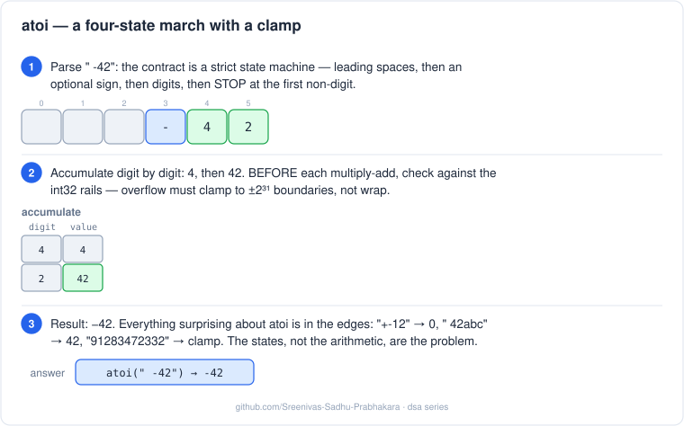

# Implement ATOI and STRSTR

> Striver SDE Sheet 095 · Day 15 String — atoi is a tiny state machine with a clamping rule; strstr is the honest quadratic scan (the linear versions come later in the sheet). Go, stdlib only, tested.

## Problem

Two C-library staples, specified as interviews expect them: **atoi** — skip spaces, one optional sign, digits until a non-digit, clamp to 32-bit range; **strstr** — index of the first occurrence of a needle, 0 for an empty needle, -1 if absent.

## Approach

Atoi is pure specification discipline: the algorithm is trivial, the marks are for the edge decisions — `"+-12"` is 0 (one sign max), `"words and 987"` is 0 (no leading digits), overflow clamps rather than wraps, and the clamp triggers *during* accumulation so the running total never itself overflows 64-bit space. Strstr here is the straightforward scan with Go's slice comparison; it is O(n·m) worst case on pathological inputs, and that's fine — the sheet deliberately circles back with Rabin–Karp (#097), Z (#098) and KMP (#099) to earn linearity three different ways.

**Complexity:** Atoi O(n); StrStr O(n·m) worst case.

## Visual walkthrough

Read the picture top to bottom — each numbered frame is one moment of the algorithm
running on this repo's test example.

## Run

    go test ./...   # verify
    go run .        # demo

---

One of 191 repos solving Striver's SDE Sheet in Go — stdlib only, one problem per repo, every solution tested. Browse the set: [`dsa-*` repos](https://github.com/Sreenivas-Sadhu-Prabhakara?tab=repositories&q=dsa-&type=source).
